# Active Directory & Linux Home Lab

A small corporate network built from scratch on VMware Workstation to practise the Blue Team / SOC side of security: a Windows Server 2025 domain controller, a domain-joined Windows 11 workstation and an Ubuntu Server, with hardened policies, security auditing, attack simulation and log analysis scripts.

This is **Project 1** of my SOC portfolio. The same lab is reused and extended by the later projects (network traffic analysis, attack tracing, SIEM, phishing analysis).

---

## Lab architecture

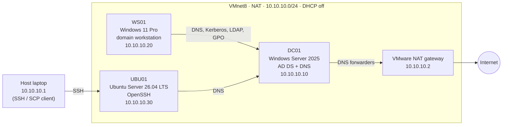

| Host | OS | Role | IP |
|---|---|---|---|
| DC01 | Windows Server 2025 (Desktop Experience) | Domain controller, DNS, time source for the domain | 10.10.10.10 |
| WS01 | Windows 11 Pro | Employee workstation, joined to `lab.local` | 10.10.10.20 |
| UBU01 | Ubuntu Server 26.04 LTS (no GUI) | Linux server with OpenSSH | 10.10.10.30 |

Domain: `lab.local` (NetBIOS `LAB`). All machines use static IPs and the `SE Asia Standard Time` / `Asia/Ho_Chi_Minh` time zone (UTC+7).

Resources on a 16 GB laptop: DC01 3 GB RAM, WS01 4 GB, UBU01 2 GB.

## Skills demonstrated

- Building an isolated lab network and planning IP addressing
- Deploying Active Directory Domain Services and DNS, joining clients to a domain
- Modelling an organisation with OUs, role-based security groups and users
- Group Policy: password and account-lockout policy, advanced audit policy, command-line and PowerShell script-block logging
- Simulating password brute force and investigating it from Windows Security events (4625, 4771, 4740)
- PowerShell automation for AD administration and security auditing
- Linux server administration over SSH, `auth.log` analysis, Bash/awk scripting
- Tuning a detection rule to cut false positives
- Troubleshooting time synchronisation, DNS and disk space problems

---

## Build log

### 1. Lab network and virtual machines

VMware's NAT network (VMnet8) was moved to `10.10.10.0/24` with DHCP disabled, so every address is assigned on purpose and the lab stays separate from the home network.

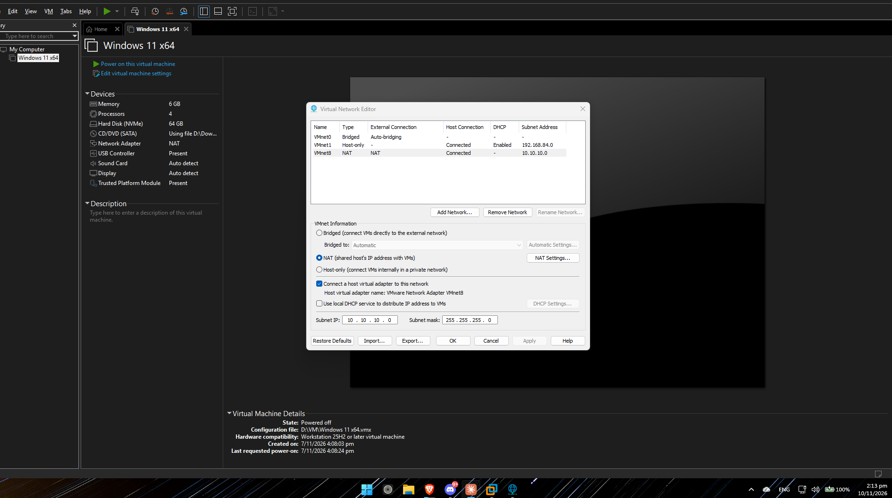

### 2. Domain controller

DC01 was given a static IP, renamed, promoted to the first domain controller of a new forest `lab.local`, and pointed its DNS at itself (`::1` / `127.0.0.1`) with forwarders for internet names.

| `ipconfig /all` on DC01 | Domain name resolves to the DC |
|---|---|
| 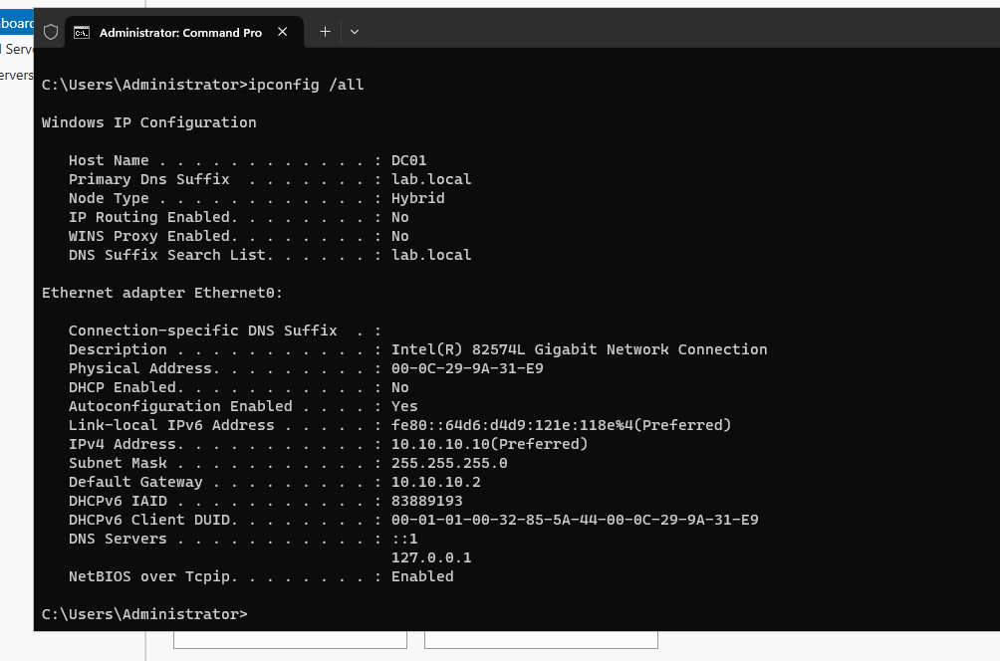 | 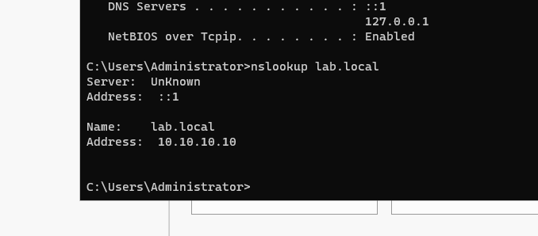 |

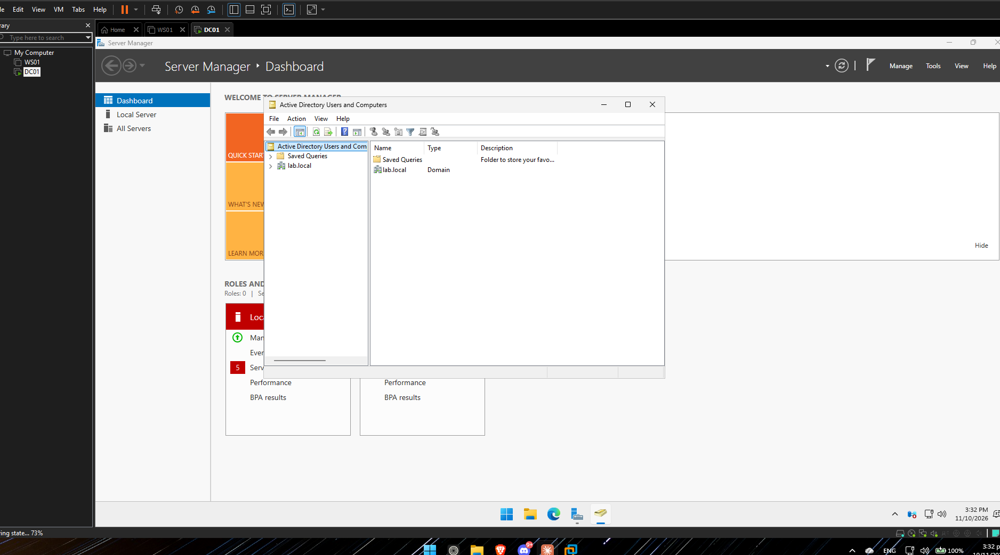

**Time sync:** after joining WS01, the two machines showed different times. Kerberos rejects logons when clocks differ by more than 5 minutes, and logs with wrong timestamps break any investigation. DC01 was configured as the reliable NTP source for the domain (`w32tm /config /manualpeerlist:... /reliable:yes`), both machines were set to the same time zone (`tzutil`), and WS01 now takes its time from `DC01.lab.local`.

### 3. Organisation structure

A fictional company, **LabCorp**, with one OU per department plus OUs for groups and workstations:

```
lab.local
└── LabCorp
    ├── IT        nguyen.an, hoang.em, dang.linh
    ├── HR        tran.binh, vu.giang, ngo.mai
    ├── Sales     le.chi, pham.dung, do.hai, bui.khanh
    ├── Groups    GRP_IT, GRP_HR, GRP_Sales  (Global Security)
    └── Workstations   WS01
```

| | | |
|---|---|---|
| 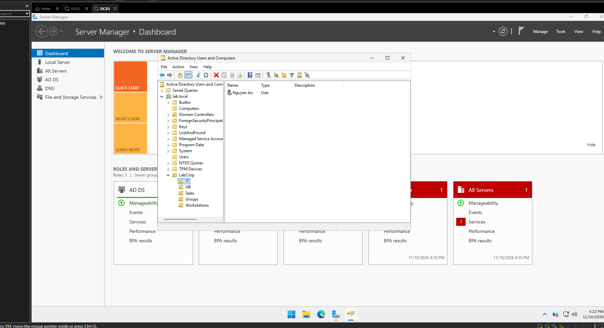 | 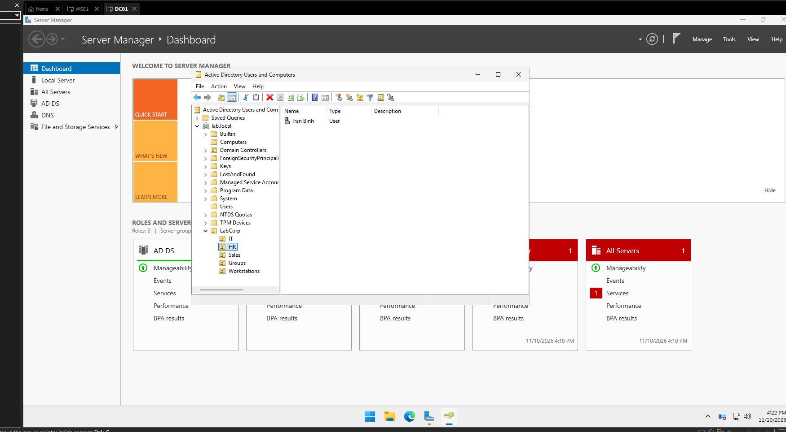 | 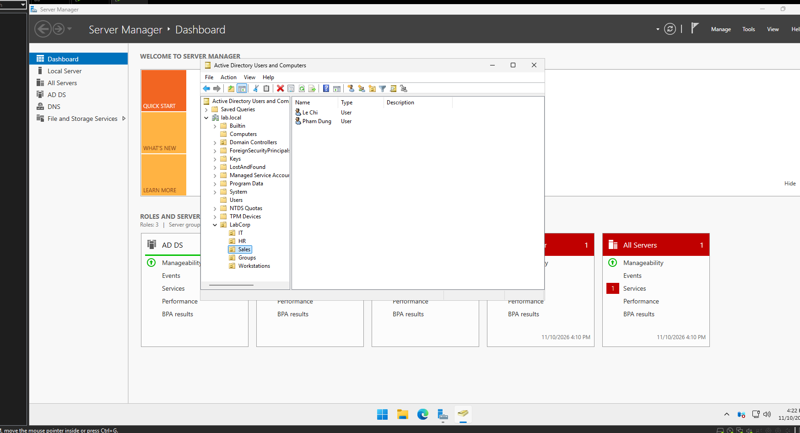 |

WS01 was joined to the domain and moved to the `Workstations` OU. A standard employee account (`LAB\le.chi`) can sign in but has no local admin rights, so system changes trigger a UAC prompt for admin credentials.

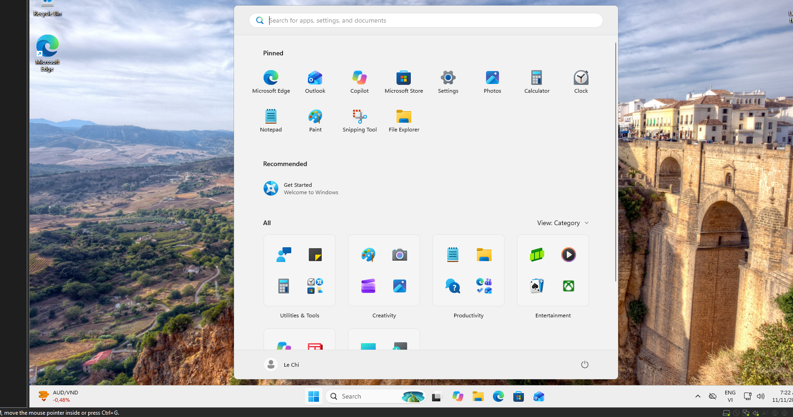

### 4. Group Policy and security auditing

**Default Domain Policy** (password policy must be linked at the domain root to apply to domain accounts):

| Setting | Value |
|---|---|
| Minimum password length | 12 |
| Complexity requirements | Enabled |
| Password history | 10 |
| Account lockout threshold | 5 invalid attempts |
| Lockout duration / counter reset | 15 minutes |

**`LAB - Audit Policy`** GPO, linked to `lab.local`. Full settings and the reasoning for each are in [docs/audit-policy.md](docs/audit-policy.md). In short: advanced auditing for logons, Kerberos, account and group changes, process creation with **command line**, **PowerShell script-block logging**, and a 500 MB Security log.

Verified on WS01 with `gpresult /r /scope computer` and `auditpol /get /category:*`. Raw output: [docs/evidence/ws01-gpresult-auditpol.txt](docs/evidence/ws01-gpresult-auditpol.txt).

#### Test: password brute force against a domain account

Five wrong passwords for `LAB\le.chi` on WS01 locked the account:

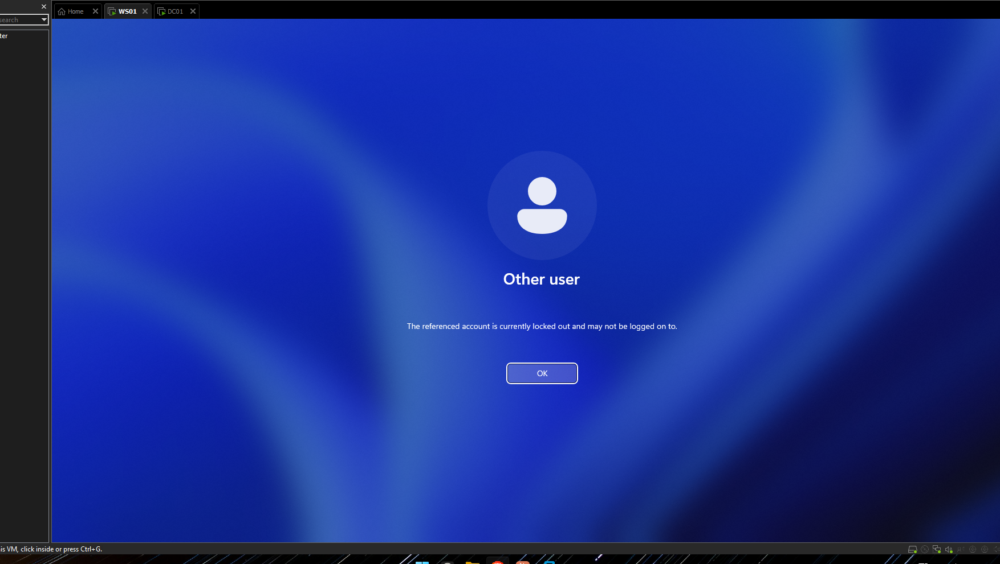

On DC01, Event **4740** records the lockout. For this event the `TargetDomainName` field holds the *caller computer*, which points straight at the source of the attempts (WS01). Event **4771** (Kerberos pre-authentication failed) is logged on the DC for each wrong password, and **4625** on the workstation.

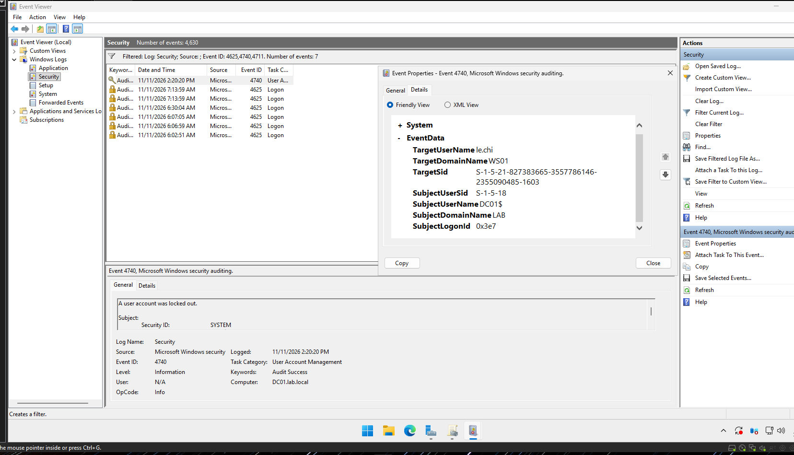

### 5. PowerShell automation

Scripts are in [`scripts/powershell`](scripts/powershell).

**`New-LabUsers.ps1`** creates users in bulk from [`users.csv`](scripts/powershell/users.csv): checks the department OU exists, skips accounts that already exist, creates the user (must change password at first logon), adds them to `GRP_<Department>`, and logs every action. The initial password is asked for at run time as a `SecureString`, never stored in the script or the CSV. Supports `-WhatIf`.

The CSV deliberately contains two bad rows: an existing user (`le.chi`) and a department without an OU (`Finance`). Both were skipped as designed:

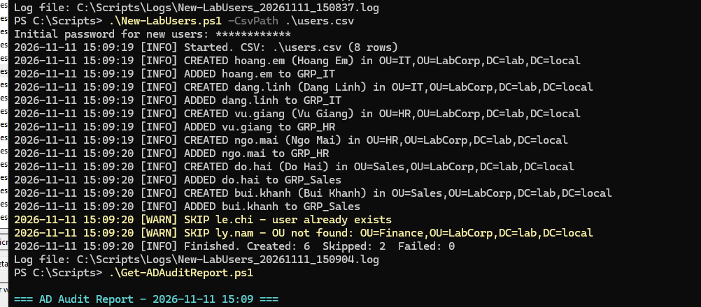

Creating six accounts in two seconds also leaves a trail SOC analysts watch for: Events **4720** (user created) and **4728** (member added to a global group) on the DC, and Event **4104** with the full script text in the PowerShell Operational log.

**`Get-ADAuditReport.ps1`** is read-only. It looks for privileged group members, locked-out accounts, accounts with *password not required*, passwords that never expire, inactive or never-used accounts, and disabled accounts, then exports CSV and HTML reports.

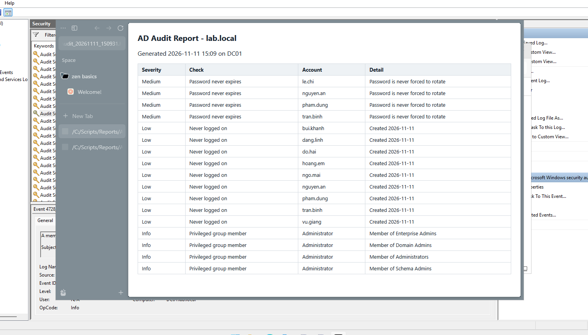

The first report flagged **Password never expires** on the four users created by hand in step 3. I had ticked that box "for convenience". The script caught a misconfiguration in my own lab. Remediation:

```powershell
'nguyen.an','tran.binh','le.chi','pham.dung' | ForEach-Object { Set-ADUser $_ -PasswordNeverExpires $false }
```

### 6. Linux server and SSH log analysis

UBU01 runs Ubuntu Server without a GUI (smaller attack surface, like most production servers) and is managed over SSH from the host. On first SSH connection the server's ED25519 fingerprint was checked against the one printed at first boot before accepting it.

| First boot: SSH host keys | Disk layout without LVM | Network and DNS test |
|---|---|---|
| 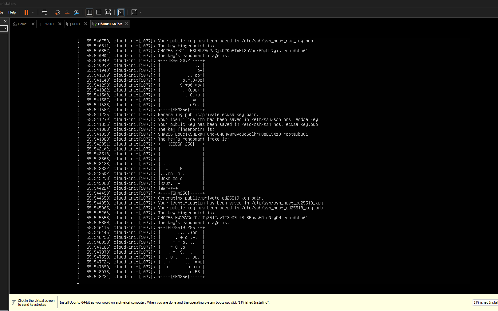 | 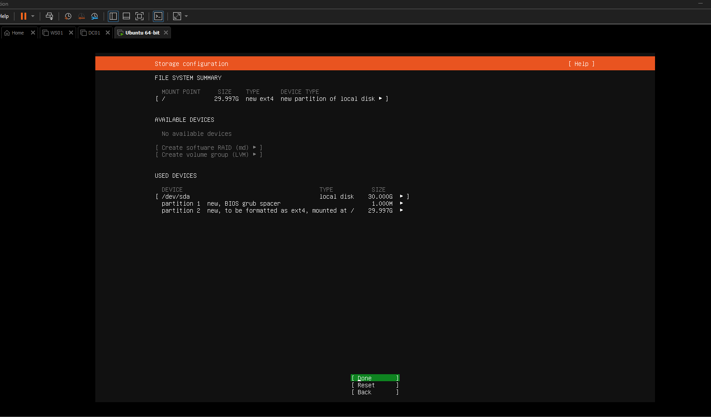 | 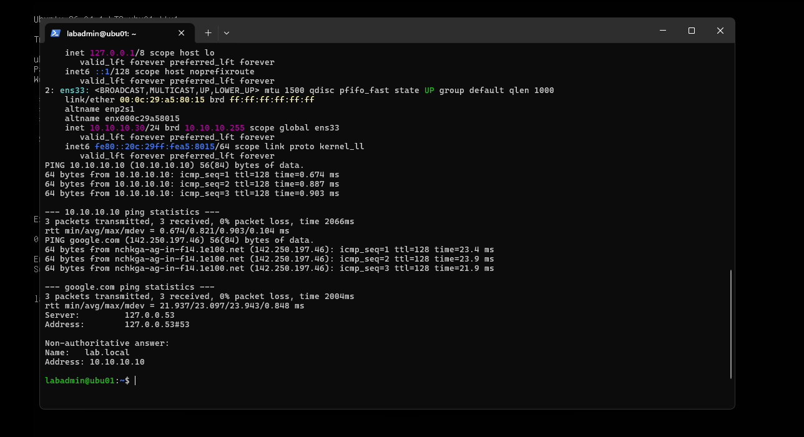 |

A typo in the username (`ladadmin` instead of `labadmin`) produced the first "attack" in `/var/log/auth.log`. *Invalid user* entries like these are a classic sign of username guessing:

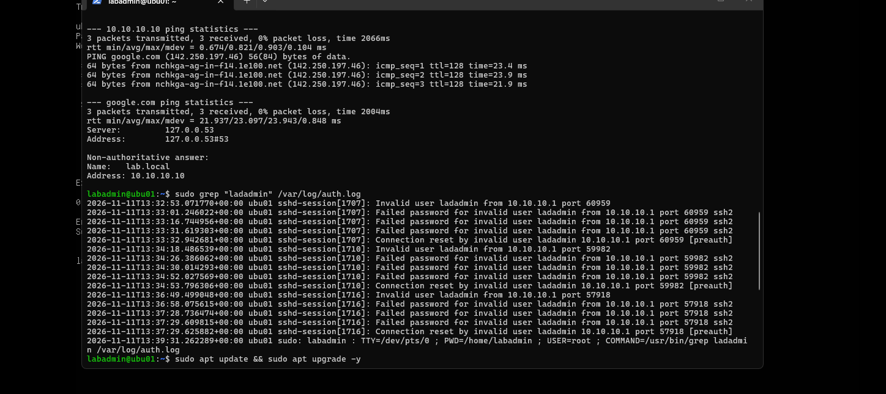

**`ssh-log-analyzer.sh`** ([`scripts/bash`](scripts/bash)) parses `auth.log` (both the ISO-8601 and classic syslog formats) with `grep` and `awk` and reports:

- failed passwords per source IP, flagging any IP at or above a threshold as **POSSIBLE BRUTE FORCE**
- usernames tried that do not exist on the host
- successful logins, and **successful logins from an IP that failed first** (a guessed password)
- `sudo` usage per user

```bash
sudo ./ssh-log-analyzer.sh            # defaults: /var/log/auth.log, threshold 5
sudo ./ssh-log-analyzer.sh -t 10 -n 5 # custom threshold and top-N
```

#### Tuning out a false positive

The first version never reset an IP's failure count after a successful login, so **every** later login from my own laptop was flagged, including one with no failures before it:

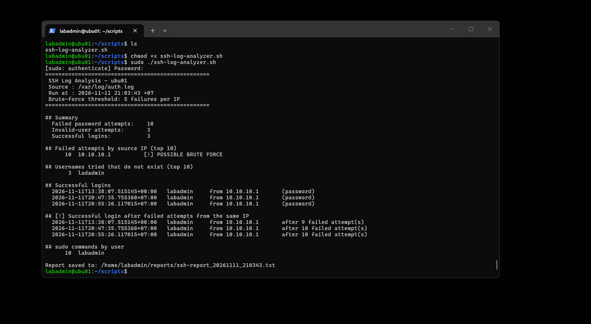

One line resets the counter after each success:

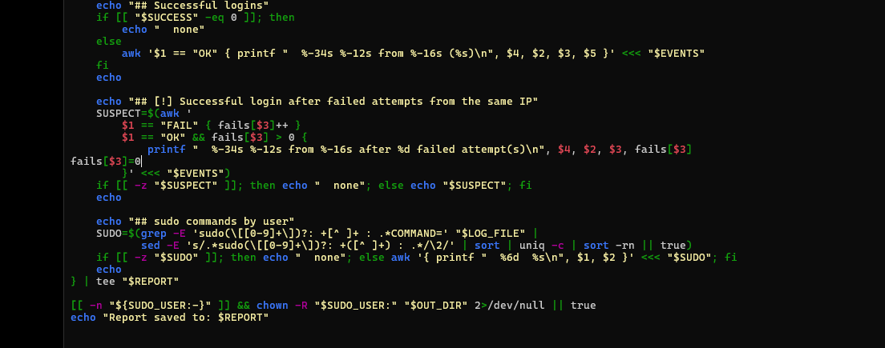

Now only logins that really followed failures are flagged:

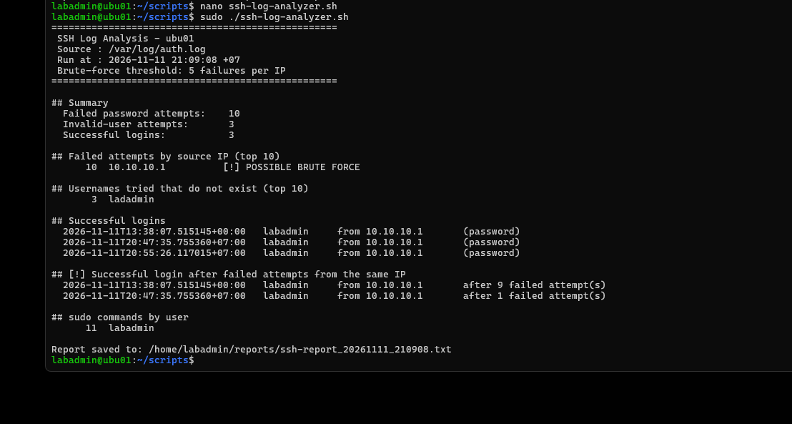

#### Simulated attack from another host

From DC01, SSH logins were attempted with common bot usernames (`admin`, `test`, `oracle`, `root`) and wrong passwords:

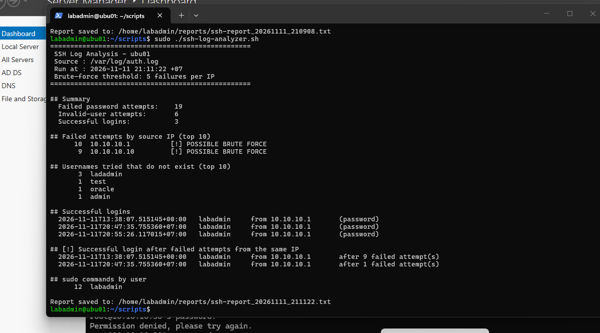

The report shows a second source, `10.10.10.10`, over the threshold, the guessed usernames, and **no successful login from that IP**. Write-up: [docs/incident-ssh-brute-force.md](docs/incident-ssh-brute-force.md).

---

## Lessons learned

- **Time is evidence.** Unsynchronised clocks broke Kerberos and produced events with misleading timestamps. The SSH log still mixes `+00:00` and `+07:00` entries from before and after the time zone change, which is why a SIEM normalises time before correlating anything.
- **Snapshots are not free.** Snapshots taken while VMs were running stored full RAM images, and a chain of seven filled the disk mid-session, pausing both VMs. Fix: freed space, consolidated to two snapshots per VM, and now snapshot only after a clean shutdown.

  | | |
  |---|---|
  | 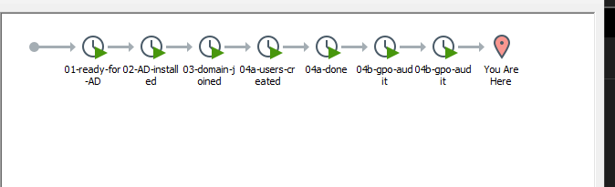 | 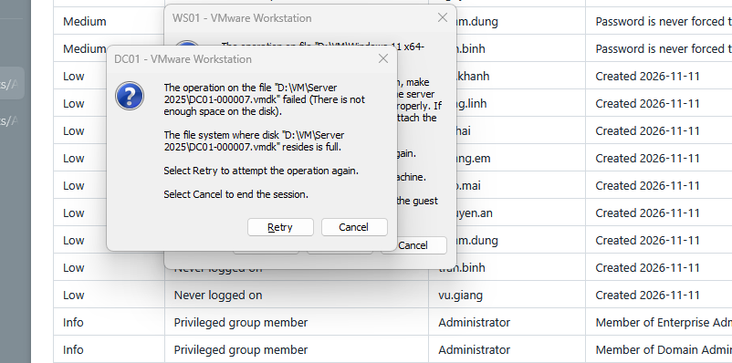 |

- **Patched is not the same as protected.** After `apt upgrade` the server kept running the old kernel until rebooted.
- **Alerts need tuning.** A rule that is technically correct but fires on normal behaviour trains analysts to ignore it.
- **Lab shortcuts show up in audits.** "Password never expires" was set to save time and was the first finding.
- `.local` is fine for a lab; a real organisation should use a subdomain of a domain it owns (for example `ad.example.com`).

## Next steps

- Project 2: capture and analyse this network's traffic (Wireshark, tcpdump, Nmap)
- Project 3: attack the lab with Hydra, Gobuster and SQLMap and trace every technique in the logs, mapped to MITRE ATT&CK
- Project 4: Wazuh SIEM with Sysmon and Suricata, custom detection rules for the attacks above
- Switch UBU01 to key-based SSH and disable password authentication once the brute-force exercises are finished

## Repository layout

```
.
├── README.md
├── credentials.example.md      template only, real credentials are never committed
├── docs/
│   ├── audit-policy.md
│   ├── incident-ssh-brute-force.md
│   └── evidence/ws01-gpresult-auditpol.txt
├── scripts/
│   ├── powershell/  New-LabUsers.ps1, Get-ADAuditReport.ps1, users.csv
│   └── bash/        ssh-log-analyzer.sh
└── screenshots/
```

## Credentials

No real credentials are stored in this repository. See [credentials.example.md](credentials.example.md) for which accounts exist; set your own passwords when rebuilding the lab.
